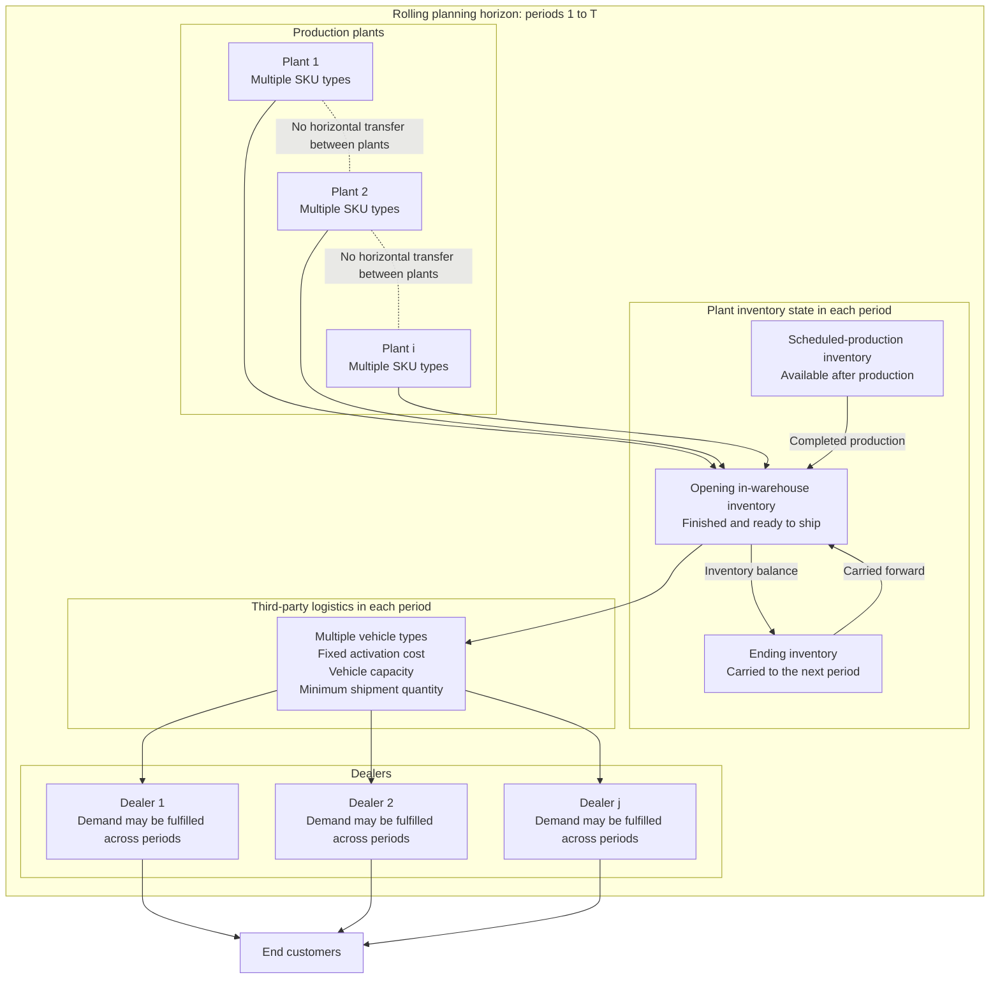

# Multi-period Production-driven Product Distribution Problem

## Business Context

The multi-period production-driven product distribution problem extends the
single-period model to rolling operations. The retailer does not treat
replenishment as one static decision. Instead, production and delivery are
managed over multiple consecutive planning periods.

Dealer demand can be fulfilled cumulatively over the planning horizon, while
plants complete production according to a period-specific production schedule.
Delivery decisions must therefore account for both cross-period inventory
dynamics and production timing. The objective is to minimize total cost over
the complete horizon.

## System Structure

A large retail company owns multiple production plants and serves multiple
dealers that distribute multiple SKU types to end customers.

Important structural properties are:

- multiple plants can supply the same SKU;
- one plant can serve multiple dealers;
- one dealer can receive shipments from multiple plants;
- horizontal transfers between plants are prohibited;
- the 3PL provides multiple vehicle types with fixed activation costs.

Plant inventory has two parts:

1. **In-warehouse inventory**

   Finished products available at the beginning of a period and ready for
   shipment.
2. **Scheduled-production inventory**

   Products assigned to the production plan for a period. They become
   available only after production is completed and converted into
   in-warehouse inventory.

## Decision Problem

For every period in the planning horizon, the company must jointly determine:

- how much of each SKU is shipped from each plant to each dealer;
- whether a vehicle is activated;
- which vehicle type is used;
- which plant-dealer shipment is assigned to each vehicle;
- how SKU quantities are loaded across vehicles;
- the end-of-period inventory carried into the next period.

The objective is to minimize the total fee paid to the 3PL over all periods.
The fee includes fixed vehicle activation costs and penalties for vehicles
whose loaded volume falls below the minimum shipment quantity.

## Core Constraints

1. **Demand coverage across the horizon**

   For every dealer and SKU, the total quantity shipped from all plants over
   all periods must satisfy the total demand of that dealer and SKU.
2. **Inventory-flow balance**

   For each plant, SKU, and period, the shipped quantity equals:

   ```text
   production in the period
   + opening inventory
   - ending inventory
   ```

   This equation captures the dynamic coupling between production, delivery,
   and inventory carried across periods.
3. **Plant inventory-capacity constraint**

   At the end of every period, the total inventory of all SKUs at a plant
   cannot exceed that plant's storage capacity.
4. **Vehicle capacity constraint**

   The total volume loaded into a vehicle cannot exceed the capacity of its
   vehicle type.
5. **Minimum shipment quantity**

   If a used vehicle is loaded below the required threshold, a penalty cost is
   incurred. This follows the commercial rule of the 3PL and discourages
   inefficient shipments.

## Modeling Assumptions

1. **Sufficient supply over the full horizon**

   For every SKU, total supply from opening inventory and scheduled production
   is at least total demand. Global stockout therefore does not make the model
   infeasible.
2. **Exogenous production plan**

   Production quantities by plant, SKU, and period are known parameters. They
   are not decision variables in this optimization problem.
3. **One-dimensional measurement**

   SKU volume and vehicle capacity use a linear volume scale. Weight, stacking,
   and other complex geometric loading constraints are ignored.
4. **Unlimited vehicle availability**

   The 3PL can provide an unlimited number of vehicles. Vehicle-type selection
   is driven only by cost.

## Problem Diagram



The diagram shows the rolling relationship among scheduled production,
in-warehouse inventory, vehicle loading and delivery, dealer demand, and
end-of-period inventory. The same structural relationships repeat in every
period, while ending inventory links adjacent periods.

## Code Relationship

- `src/multi_period_delivery/alns_optimizer.py` coordinates the ALNS search.
- `src/multi_period_delivery/destroy_operators.py` and
  `src/multi_period_delivery/repair_operators.py` define the search
  neighborhood.
- `src/multi_period_delivery/inventory_utils.py` and related inventory modules
  maintain cross-period inventory balance.
- `src/multi_period_delivery/monolithic/` implements the ILP benchmark.
- `experiments/` contains the thesis experiment and reporting pipeline.
