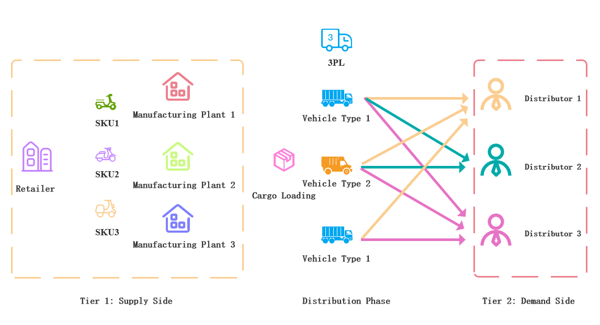

# Single-period Product Distribution Problem

## Business Context

The single-period product distribution problem is the foundational static
scenario in the thesis. It represents one planning period of routine retail
replenishment for a large electric-vehicle retailer.

Within this period, production and inventory are treated as fixed inputs. The
company must decide how to allocate available SKU inventory from plants to
dealers and how to pack those shipments into vehicles provided by a
third-party logistics provider (3PL). The decision directly affects short-term
logistics cost and the company's ability to respond to end-market demand.

The model deliberately excludes cross-period production planning and dynamic
inventory transfer. This isolates the core relationships among inventory
allocation, vehicle-type selection, and loading optimization.

## System Structure

The two-level supply chain contains:

- multiple production plants;
- multiple dealers;
- multiple SKU types;
- a heterogeneous 3PL vehicle fleet;
- end customers served by the dealers.

For every SKU, multiple plants may be able to supply the same SKU. A single
plant may serve multiple dealers, and a single dealer may receive shipments
from multiple plants. The supply network therefore has a many-to-many
structure.

Horizontal transfers between plants are prohibited because of geographic
separation and long-distance transport costs.

## Decision Problem

The company must jointly determine:

- how much of each SKU is shipped from each plant to each dealer;
- whether a vehicle is used;
- which vehicle type is assigned;
- which plant-dealer shipment is loaded onto each vehicle;
- how individual SKU quantities are distributed across vehicles.

The objective is to minimize the total fee paid by the retailer to the 3PL.
Vehicle-type selection is associated with a fixed activation cost.

## Core Constraints

1. **Demand coverage**

   The total quantity of each SKU delivered to each dealer must fully satisfy
   that dealer's demand.

   *Implementation note:* the thesis model states this as an equality; the
   archived code uses `>=`. Over-delivery is therefore legal, which is what
   allows an already-activated vehicle to be topped up to its minimum load
   instead of activating another one. See
   [`../../docs/model_implementation_audit.md`](../../docs/model_implementation_audit.md).

2. **Supply capacity**

   The quantity of a SKU shipped from a plant cannot exceed the inventory held
   by that plant. No additional production is available during the period.

3. **Vehicle capacity**

   The total volume loaded into a vehicle cannot exceed the capacity of its
   vehicle type.

4. **Minimum shipment quantity**

   If the loaded volume of a vehicle is below the required threshold, a
   penalty cost is incurred. This reflects the commercial rules of the 3PL and
   encourages higher vehicle utilization.

## Modeling Assumptions

1. **Sufficient aggregate supply**

   The total inventory of each SKU across plants is at least the total dealer
   demand. This avoids global infeasibility caused by stockout.

2. **Production silence**

   Production plans are ignored and plant inventory is treated as a static
   parameter for the single-period decision.

3. **One-dimensional measurement**

   SKU volume and vehicle capacity use a linear volume scale. Weight,
   stacking, loading order, and complex geometric constraints are ignored.

4. **Unlimited vehicle availability**

   The 3PL can provide an unlimited number of vehicles. Vehicle-type selection
   is driven only by cost.

   *Implementation note:* the archived monolithic model does **not** implement
   this literally. `InputDataSingle.load()` derives one global fleet size
   (`max_veh_num`), assigns each vehicle a type **at random**, and the model can
   then use that fixed fleet. On `small/dataset_1` this yields 235 vehicles,
   which is what makes the monolithic model large enough to need a
   column-generation alternative; see
   [`../../docs/model_implementation_audit.md`](../../docs/model_implementation_audit.md)
   for the measurements and the recommended reformulation.

## Problem Diagram

The diagram shows a many-to-many supply structure. Each plant may supply
multiple dealers, and each dealer may receive the same SKU from multiple
plants. All shipments pass through the integrated loading and delivery
decision managed by the 3PL.

## Code Relationship

- `src/single_period_delivery/monolithic/` solves the direct
  integer-programming model.
- `src/single_period_delivery/column-generation/` implements master and
  pricing models for the column-generation method.
- `src/single_period_delivery/heuristic/` implements the two-stage heuristic
  for fast response.
